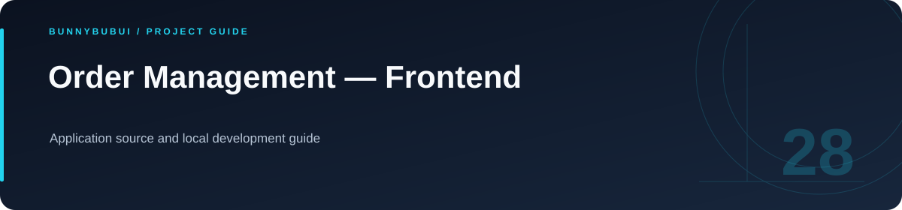

<p align="center">
  
</p>

<h1 align="center">Order Management — Frontend</h1>

<p align="center">Application source and local development guide</p>

<p align="center">
       
</p>

<p align="center"><a href="#overview">ภาพรวม</a> · <a href="#start">เริ่มใช้งาน</a> · <a href="#structure">ไฟล์สำคัญ</a></p>

<a id="overview"></a>

## ภาพรวม

โฟลเดอร์ source ของ **Order Management — Frontend** ภายใน workspace นี้ มี package และคำสั่งพัฒนาของตนเอง อ่านร่วมกับ README หลักเพื่อดูความสัมพันธ์กับระบบอื่น

<a id="start"></a>

## เริ่มต้นใช้งาน

รันจากโฟลเดอร์ `Frontend` หลังเตรียมค่าตั้งค่าและ backend ที่แอปต้องใช้

```sh
npm ci
npm run dev
```

| Script | คำสั่งใน package |
|---|---|
| `npm run dev` | `vite --host` |
| `npm run build` | `vite build` |
| `npm run lint` | `eslint .` |
| `npm run preview` | `vite preview` |

<a id="structure"></a>

## ไฟล์สำคัญ

| ตำแหน่ง | หน้าที่ |
|---|---|
| [src/](src) | source ของแอป |

<a id="reading"></a>

## อ่านต่อ

- [กลับ README หลัก](../README.md)


---

<p align="center"><a href="https://github.com/BunnyBubui">BunnyBubui</a> · <a href="https://github.com/BunnyBubui/test">Software Portfolio</a></p>
