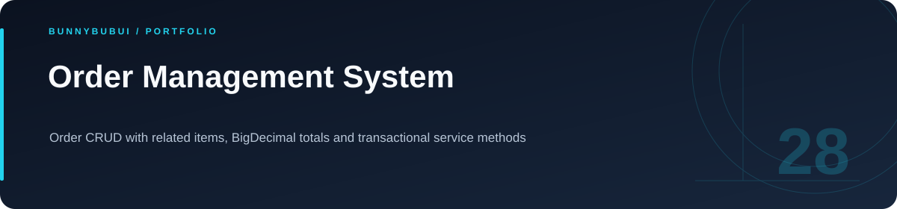
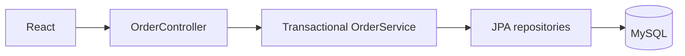

<p align="center">
  
</p>

<h1 align="center">Order Management System</h1>

<p align="center">Order CRUD with related items, BigDecimal totals and transactional service methods</p>

<p align="center">
      
</p>

<p align="center"><a href="#overview">ภาพรวม</a> · <a href="#features">ความสามารถ</a> · <a href="#start">เริ่มใช้งาน</a> · <a href="#structure">โครงสร้าง</a> · <a href="#validation">ตรวจสอบงาน</a></p>

<a id="overview"></a>

## ภาพรวม

ระบบจัดการคำสั่งซื้อที่แยก React frontend และ Spring Boot backend ใช้ JPA จัดความสัมพันธ์ของรายการสินค้า และคำนวณยอดเงินด้วย BigDecimal

<a id="features"></a>

## ความสามารถที่มีใน source

| ส่วนงาน | รายละเอียด | อ้างอิง |
|---|---|---|
| **Order CRUD** | สร้าง อ่าน แก้ไข และลบคำสั่งซื้อ | [ดู source](Backend/src/main/java/com/example/orders/controller/OrderController.java) |
| **Related items** | ความสัมพันธ์คำสั่งซื้อและรายการสินค้า | [ดู source](Backend/src/main/java/com/example/orders/model/) |
| **Money & transactions** | BigDecimal และ transactional service | [ดู source](Backend/src/main/java/com/example/orders/service/OrderService.java) |
| **Frontend** | ส่วนติดต่อผู้ใช้ React | [ดู source](Frontend/src/) |

### เส้นทางการทำงาน



<a id="start"></a>

## เริ่มต้นใช้งาน

**สิ่งที่ต้องมี:** JDK 17+ แบบมี compiler, Node.js และ MySQL; สร้างฐานข้อมูล orders ก่อนเริ่ม

```sh
cd Backend
# Export DB_URL, DB_USER and DB_PASSWORD in your shell.
./mvnw spring-boot:run

# Terminal 2, from repository root
cd Frontend
npm ci
npm run dev
```

backend ใช้พอร์ต 3000 และเส้นทาง `/orders` บน Windows ใช้ `mvnw.cmd` แทน `./mvnw`; Spring Boot ไม่โหลดไฟล์ `.env` ให้เอง

<a id="configuration"></a>

## การตั้งค่า

ตัวอย่างค่าตั้งค่าอยู่ในไฟล์ต่อไปนี้ คัดลอกไปยังชื่อไฟล์ local ที่โปรเจกต์อ่านและกำหนดค่าของเครื่องที่ใช้

| ไฟล์ตัวอย่าง | ตัวแปรสำคัญ |
|---|---|
| [Backend/.env.example](Backend/.env.example) | `DB_URL`, `DB_USER`, `DB_PASSWORD` |

<a id="api"></a>

## API โดยย่อ

| Method | เส้นทาง | หน้าที่ |
|---|---|---|
| GET / POST | `/orders` | อ่านและสร้างคำสั่งซื้อ |
| GET / PUT / DELETE | `/orders/{id}` | อ่าน แก้ไข และลบตามรหัส |

<a id="structure"></a>

## โครงสร้างที่ควรเริ่มอ่าน

| ตำแหน่ง | หน้าที่ |
|---|---|
| [Backend/](Backend) | backend API |
| [Frontend/](Frontend) | ส่วนติดต่อผู้ใช้ |

<a id="validation"></a>

## คำสั่งและผลตรวจ

| โฟลเดอร์ที่รัน | คำสั่งที่มีใน package |
|---|---|
| `Frontend` | `npm run build` |
| `Frontend` | `npm run lint` |

ดู [ผลตรวจที่บันทึกไว้](docs/VALIDATION.md) สำหรับขอบเขตการทดสอบรอบเตรียมพอร์ต

<a id="reading"></a>

## อ่านต่อ

- [คู่มือรายละเอียดเดิม](docs/SETUP_GUIDE.md)
- [บันทึกการเตรียม source](docs/CLEANUP.md)


---

<p align="center"><a href="https://github.com/BunnyBubui">BunnyBubui</a> · <a href="https://github.com/BunnyBubui/test">Software Portfolio</a></p>
